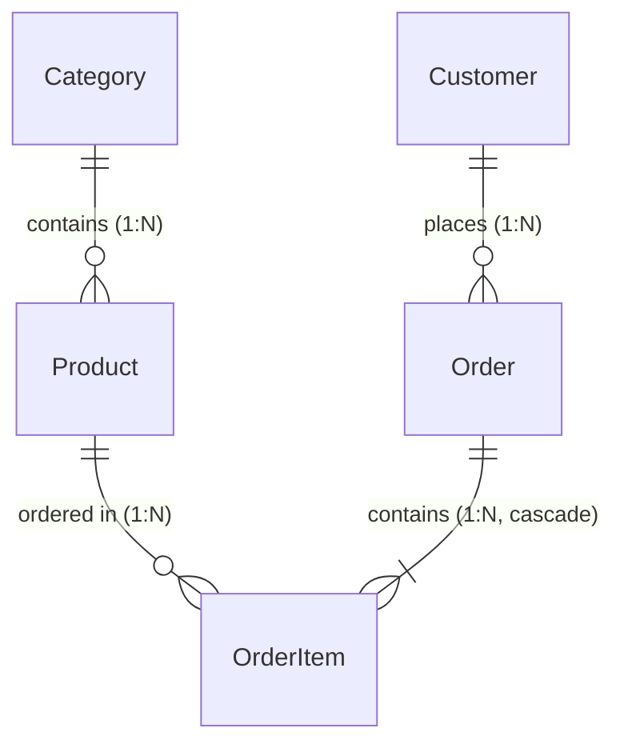

# ecommerce-api

E-commerce REST API built with Node.js, Express, TypeScript, PostgreSQL and Prisma.

**Status:** schema, seed, Express foundation and the Stage 5 read endpoints are in place.
`/api/v1` exposes paginated, filterable, sortable read routes for categories, products,
customers and orders (see [API](#7-api)).

## Requirements

- Node.js 22+ and npm
- Docker (local PostgreSQL 16)

## 1. Environment

Copy `.env.example` to `.env` and fill it in:

```bash
cp .env.example .env
```

`DATABASE_URL` points at `localhost:5432`, so the Docker container name never appears in
application config. Never commit `.env`; keep `.env.example` up to date instead.

## 2. Database (Docker)

Create the container once:

```bash
docker run -d --name ecommerce-postgres \
  -e POSTGRES_USER=user \
  -e POSTGRES_PASSWORD=password \
  -e POSTGRES_DB=ecommerce \
  -p 5432:5432 \
  -v ecommerce-postgres-data:/var/lib/postgresql/data \
  postgres:16-alpine
```

Start it in every later session - the container is not guaranteed to stay up between sessions:

```bash
docker start ecommerce-postgres
docker ps --filter name=ecommerce-postgres   # confirm it is Up
```

Open a SQL shell:

```bash
docker exec -it ecommerce-postgres psql -U user -d ecommerce
```

Alternative: add `--restart unless-stopped` to the `docker run` command so Docker starts it
automatically instead of needing `docker start`.

## 3. Install and migrate

```bash
npm install
npx prisma migrate deploy    # apply existing migrations (no prompts)
npx prisma migrate dev       # while developing: create + apply a new migration
```

## 4. Seed

```bash
npm run seed
```

- **Deterministic:** `faker.seed(42)` plus ids from `faker.string.uuid()`, a fixed order
  date window, and a fixed `createdAt` for categories/products/customers - no values depend
  on when the script runs.
- **Idempotent:** `createMany({ skipDuplicates: true })` on all five tables, so re-running
  inserts 0 rows. The script never deletes or truncates.
- **Volumes:** 20 categories, 400 products, 300 customers, 500 orders with 1-5 items each.
- **Caveat:** `npx prisma migrate reset --force` *also* runs the seed, because `prisma.seed`
  is configured in `package.json`. Use `--skip-seed` for an empty database.

## 5. Scripts

| Script | Purpose |
| --- | --- |
| `npm run dev` | Watch mode via `tsx` |
| `npm run build` | Compile to `dist/` with `tsconfig.json` |
| `npm start` | Run the compiled server from `dist/` |
| `npm test` | `vitest run` (builds a throwaway test database first) |
| `npm run seed` | Seed the database |
| `npm run typecheck` | `tsc --noEmit` over `src/` **and** `prisma/seed.ts` |
| `postinstall` | Regenerate the Prisma client (`prisma generate`) after `npm install` |

`typecheck` uses a separate `tsconfig.typecheck.json` (it extends the build config and turns
emit off), so `npm run build` keeps its `dist/` layout unchanged.

## 6. Tests

`npm test` needs Postgres running (the `ecommerce-postgres` container). The Vitest `globalSetup`
hook creates `ecommerce_test`, applies every migration and runs the seed against it, and a
`setupFiles` hook points the worker's `DATABASE_URL` at it before `src/config.ts` / `src/db.ts`
load. The test harness creates and drops its own `ecommerce_test` database, so no `DATABASE_URL`
is needed for `npm test`. Tests therefore never read or mutate your `ecommerce` data.

## Resources & Data Model

The API manages five core resources: `Category`, `Product`, `Customer`, `Order`, and `OrderItem`.

### Entity Relationship Diagram



### Database Rules & Constraints

- **Primary Keys:** UUID v4 (`@id @default(uuid()) @db.Uuid`) on all tables.
- **Foreign Keys & Deletion Rules:**
  - `Product.categoryId -> Category.id`: `ON DELETE RESTRICT` (cannot delete a category containing products).
  - `Order.customerId -> Customer.id`: `ON DELETE RESTRICT` (cannot delete a customer with order history).
  - `OrderItem.orderId -> Order.id`: `ON DELETE CASCADE` (deleting an order cascades and deletes its line items).
  - `OrderItem.productId -> Product.id`: `ON DELETE RESTRICT` (cannot delete a product referenced in orders).
- **Unique Constraints:**
  - `Category`: `name` is unique (`Category_name_key`); `slug` is unique (`Category_slug_key`).
  - `Customer`: `email` is unique (`Customer_email_key`).
- **PostgreSQL CHECK Constraints:**
  - `Order`: `chk_order_status` enforces `status IN ('pending', 'paid', 'shipped', 'cancelled')`.
  - `Product`: `chk_product_price` enforces `priceMinor >= 0`.
  - `Product`: `chk_product_stock` enforces `stock >= 0`.
  - `OrderItem`: `chk_order_item_quantity` enforces `quantity >= 1`.
  - `OrderItem`: `chk_order_item_unit_price` enforces `unitPriceMinor >= 0`.

---

### Resource Schemas

#### Category
| Field | Type | Required | Notes |
| :--- | :--- | :---: | :--- |
| `id` | `UUID` | Yes | Primary key |
| `name` | `String` | Yes | Unique category title |
| `slug` | `String` | Yes | Unique URL-safe slug derived from name |
| `createdAt` | `DateTime` | Yes | Creation timestamp (ISO 8601) |

#### Product
| Field | Type | Required | Notes |
| :--- | :--- | :---: | :--- |
| `id` | `UUID` | Yes | Primary key |
| `categoryId` | `UUID` | Yes | Foreign key to `Category.id` (`onDelete: Restrict`) |
| `name` | `String` | Yes | Product name |
| `description` | `String` | No | Optional description |
| `priceMinor` | `Integer` | Yes | Price in kobo (NGN minor units); CHECK `priceMinor >= 0` |
| `currency` | `String` | Yes | Defaults to `"NGN"` |
| `stock` | `Integer` | Yes | Inventory stock count; CHECK `stock >= 0` |
| `createdAt` | `DateTime` | Yes | Creation timestamp (ISO 8601) |

#### Customer
| Field | Type | Required | Notes |
| :--- | :--- | :---: | :--- |
| `id` | `UUID` | Yes | Primary key |
| `name` | `String` | Yes | Full name |
| `email` | `String` | Yes | Unique email address |
| `createdAt` | `DateTime` | Yes | Creation timestamp (ISO 8601) |

#### Order
| Field | Type | Required | Notes |
| :--- | :--- | :---: | :--- |
| `id` | `UUID` | Yes | Primary key |
| `customerId` | `UUID` | Yes | Foreign key to `Customer.id` (`onDelete: Restrict`) |
| `status` | `String` | Yes | Order status; CHECK `status IN ('pending', 'paid', 'shipped', 'cancelled')` |
| `currency` | `String` | Yes | Defaults to `"NGN"` |
| `createdAt` | `DateTime` | Yes | Creation timestamp (ISO 8601) |
| `updatedAt` | `DateTime` | Yes | Update timestamp (ISO 8601) |

#### OrderItem
| Field | Type | Required | Notes |
| :--- | :--- | :---: | :--- |
| `id` | `UUID` | Yes | Primary key |
| `orderId` | `UUID` | Yes | Foreign key to `Order.id` (`onDelete: Cascade`) |
| `productId` | `UUID` | Yes | Foreign key to `Product.id` (`onDelete: Restrict`) |
| `quantity` | `Integer` | Yes | Count ordered; CHECK `quantity >= 1`, max 1000 |
| `unitPriceMinor` | `Integer` | Yes | Unit price in kobo copied from product at order time; CHECK `unitPriceMinor >= 0` |

---

---

## Endpoint Reference

All endpoints are mounted under `/api/v1`. 

> [!NOTE]
> **PowerShell Users:** Use `curl.exe` instead of `curl` (which is aliased to `Invoke-WebRequest`). For JSON request bodies, write the payload to a `.json` file and pass `--data "@body.json"` to prevent PowerShell from stripping quotes.

Every example below targets `https://LIVE_URL_PLACEHOLDER`. Collection outputs use `limit=2` and are shortened for brevity.

---

### 1. Health Check

#### `GET /api/v1/health`
Returns server operational status.

- **Query Parameters:** None
- **cURL:**
  ```bash
  curl -s "https://LIVE_URL_PLACEHOLDER/api/v1/health"
  ```
- **Response (`200 OK`):**
  ```json
  {
    "data": {
      "status": "ok"
    }
  }
  ```

---

### 2. Categories

#### `GET /api/v1/categories`
List categories with pagination, sorting, and search filters.

- **Query Parameters:**
  - `limit` (`integer`, optional, default: `20`, max: `100`): Page size.
  - `offset` (`integer`, optional, default: `0`, min: `0`): Number of records to skip.
  - `sort` (`string`, optional, default: `name`): Whitelist: `name`, `createdAt`.
  - `order` (`string`, optional, default: `asc`): `asc` or `desc`.
  - `name` (`string`, optional): Case-insensitive substring match.
  - `slug` (`string`, optional): Exact lowercase slug match.
- **cURL:**
  ```bash
  curl -s "https://LIVE_URL_PLACEHOLDER/api/v1/categories?limit=2"
  ```
- **Response (`200 OK`, shortened):**
  ```json
  {
    "data": [
      {
        "id": "fd46d528-eb91-49f2-a8eb-bb54ccde88ca",
        "name": "Appliances",
        "slug": "appliances",
        "createdAt": "2026-01-01T00:00:00.000Z"
      },
      {
        "id": "91ffb84d-a2ed-4fb9-96ed-006cf296fdd7",
        "name": "Automotive",
        "slug": "automotive",
        "createdAt": "2026-01-01T00:00:00.000Z"
      }
    ],
    "meta": {
      "total": 20,
      "limit": 2,
      "offset": 0,
      "hasMore": true
    }
  }
  ```

#### `GET /api/v1/categories/:id`
Retrieve a single category by UUID.

- **Path Parameters:**
  - `id` (`UUID`, required): Category ID.
- **Query Parameters:** None
- **cURL:**
  ```bash
  curl -s "https://LIVE_URL_PLACEHOLDER/api/v1/categories/fd46d528-eb91-49f2-a8eb-bb54ccde88ca"
  ```
- **Response (`200 OK`):**
  ```json
  {
    "data": {
      "id": "fd46d528-eb91-49f2-a8eb-bb54ccde88ca",
      "name": "Appliances",
      "slug": "appliances",
      "createdAt": "2026-01-01T00:00:00.000Z"
    }
  }
  ```

#### `GET /api/v1/categories/:id/products`
List all products belonging to a specific category.

- **Path Parameters:**
  - `id` (`UUID`, required): Category ID.
- **Query Parameters:**
  - `limit` (`integer`, optional, default: `20`, max: `100`): Page size.
  - `offset` (`integer`, optional, default: `0`, min: `0`): Number of records to skip.
  - `sort` (`string`, optional, default: `createdAt`): Whitelist: `price`, `name`, `createdAt`.
  - `order` (`string`, optional, default: `desc`): `asc` or `desc`.
  - `minPrice` (`integer`, optional, min: `0`): Minimum price in kobo.
  - `maxPrice` (`integer`, optional, min: `0`): Maximum price in kobo (must be `>= minPrice`).
  - `inStock` (`string`, optional): `true`, `false`, `1`, or `0`.
- **cURL:**
  ```bash
  curl -s "https://LIVE_URL_PLACEHOLDER/api/v1/categories/fd46d528-eb91-49f2-a8eb-bb54ccde88ca/products?limit=2"
  ```
- **Response (`200 OK`, shortened):**
  ```json
  {
    "data": [
      {
        "id": "0a9ba142-db35-4f9c-943c-aa89b45d48bf",
        "name": "Premium Microwave",
        "priceMinor": 6449600,
        "currency": "NGN",
        "stock": 254,
        "createdAt": "2026-01-01T00:00:00.000Z"
      },
      {
        "id": "0be2abea-f558-460b-acb5-850811c0f8f0",
        "name": "Original Vacuum Cleaner",
        "priceMinor": 10681500,
        "currency": "NGN",
        "stock": 254,
        "createdAt": "2026-01-01T00:00:00.000Z"
      }
    ],
    "meta": {
      "total": 20,
      "limit": 2,
      "offset": 0,
      "hasMore": true
    }
  }
  ```

---

### 3. Products

#### `GET /api/v1/products`
List products across all categories with dual pagination (offset or forward cursor).

- **Query Parameters:**
  - `limit` (`integer`, optional, default: `20`, max: `100`): Page size.
  - `offset` (`integer`, optional, default: `0`, min: `0`): Offset paging (mutually exclusive with `cursor`).
  - `cursor` (`string`, optional): Base64URL opaque token from previous `meta.nextCursor` (mutually exclusive with `offset`).
  - `sort` (`string`, optional, default: `price`): Whitelist: `price`, `name`, `createdAt`.
  - `order` (`string`, optional, default: `asc`): `asc` or `desc`.
  - `category` (`string`, optional): Category slug (e.g. `groceries`).
  - `minPrice` (`integer`, optional, min: `0`): Minimum price in kobo.
  - `maxPrice` (`integer`, optional, min: `0`): Maximum price in kobo.
  - `inStock` (`string`, optional): `true`, `false`, `1`, or `0`.
- **cURL:**
  ```bash
  curl -s "https://LIVE_URL_PLACEHOLDER/api/v1/products?limit=2"
  ```
- **Response (`200 OK`, shortened):**
  ```json
  {
    "data": [
      {
        "id": "6dc892dc-a7fe-4a59-8964-6964c815ec5f",
        "name": "Everyday Granulated Sugar - 500g",
        "description": "Durable granulated sugar for daily needs.",
        "priceMinor": 145400,
        "currency": "NGN",
        "stock": 77,
        "createdAt": "2026-01-01T00:00:00.000Z",
        "category": {
          "id": "72669a05-a8da-421a-809f-96a78f6fe311",
          "name": "Groceries",
          "slug": "groceries"
        }
      },
      {
        "id": "6a4609c6-6132-478f-9198-8d30a5044926",
        "name": "Everyday Conditioner - 250ml",
        "description": "Everyday conditioner that does the job.",
        "priceMinor": 165600,
        "currency": "NGN",
        "stock": 293,
        "createdAt": "2026-01-01T00:00:00.000Z",
        "category": {
          "id": "ce561907-8490-40d5-928c-391088abf85c",
          "name": "Beauty & Personal Care",
          "slug": "beauty-personal-care"
        }
      }
    ],
    "meta": {
      "total": 400,
      "limit": 2,
      "offset": 0,
      "hasMore": true,
      "nextCursor": "NmE0NjA5YzYtNjEzMi00NzhmLTkxOTgtOGQzMGE1MDQ0OTI2"
    }
  }
  ```

#### `GET /api/v1/products/:id`
Retrieve a single product by UUID.

- **Path Parameters:**
  - `id` (`UUID`, required): Product ID.
- **Query Parameters:** None
- **cURL:**
  ```bash
  curl -s "https://LIVE_URL_PLACEHOLDER/api/v1/products/6dc892dc-a7fe-4a59-8964-6964c815ec5f"
  ```
- **Response (`200 OK`):**
  ```json
  {
    "data": {
      "id": "6dc892dc-a7fe-4a59-8964-6964c815ec5f",
      "name": "Everyday Granulated Sugar - 500g",
      "description": "Durable granulated sugar for daily needs.",
      "priceMinor": 145400,
      "currency": "NGN",
      "stock": 77,
      "createdAt": "2026-01-01T00:00:00.000Z",
      "category": {
        "id": "72669a05-a8da-421a-809f-96a78f6fe311",
        "name": "Groceries",
        "slug": "groceries"
      }
    }
  }
  ```

---

### 4. Customers

#### `GET /api/v1/customers`
List customers with pagination, sorting, and name/email search filters.

- **Query Parameters:**
  - `limit` (`integer`, optional, default: `20`, max: `100`): Page size.
  - `offset` (`integer`, optional, default: `0`, min: `0`): Offset.
  - `sort` (`string`, optional, default: `name`): Whitelist: `name`, `createdAt`.
  - `order` (`string`, optional, default: `asc`): `asc` or `desc`.
  - `name` (`string`, optional): Case-insensitive substring match.
  - `email` (`string`, optional): Case-insensitive substring match.
- **cURL:**
  ```bash
  curl -s "https://LIVE_URL_PLACEHOLDER/api/v1/customers?limit=2"
  ```
- **Response (`200 OK`, shortened):**
  ```json
  {
    "data": [
      {
        "id": "ae3a192b-4792-4b4a-a2b2-63b4ee3916ba",
        "name": "Abagail Bogisich",
        "email": "abagail.bogisich.210@example.com",
        "createdAt": "2026-01-01T00:00:00.000Z"
      },
      {
        "id": "7b3d933a-d64d-4a77-83a5-f779ec7b9737",
        "name": "Adam Raynor",
        "email": "adam.raynor.155@example.com",
        "createdAt": "2026-01-01T00:00:00.000Z"
      }
    ],
    "meta": {
      "total": 300,
      "limit": 2,
      "offset": 0,
      "hasMore": true
    }
  }
  ```

#### `GET /api/v1/customers/:id`
Retrieve a single customer by UUID.

- **Path Parameters:**
  - `id` (`UUID`, required): Customer ID.
- **Query Parameters:** None
- **cURL:**
  ```bash
  curl -s "https://LIVE_URL_PLACEHOLDER/api/v1/customers/ae3a192b-4792-4b4a-a2b2-63b4ee3916ba"
  ```
- **Response (`200 OK`):**
  ```json
  {
    "data": {
      "id": "ae3a192b-4792-4b4a-a2b2-63b4ee3916ba",
      "name": "Abagail Bogisich",
      "email": "abagail.bogisich.210@example.com",
      "createdAt": "2026-01-01T00:00:00.000Z"
    }
  }
  ```

---

### 5. Orders

#### `GET /api/v1/orders`
List orders with status and customer filters. Totals are computed across the page in one grouped query (`totalMinor`).

- **Query Parameters:**
  - `limit` (`integer`, optional, default: `20`, max: `100`): Page size.
  - `offset` (`integer`, optional, default: `0`, min: `0`): Offset.
  - `sort` (`string`, optional, default: `createdAt`): Whitelist: `createdAt`.
  - `order` (`string`, optional, default: `desc`): `asc` or `desc`.
  - `status` (`string`, optional): Whitelist: `pending`, `paid`, `shipped`, `cancelled`.
  - `customerId` (`UUID`, optional): Valid customer UUID.
- **cURL:**
  ```bash
  curl -s "https://LIVE_URL_PLACEHOLDER/api/v1/orders?limit=2"
  ```
- **Response (`200 OK`, shortened):**
  ```json
  {
    "data": [
      {
        "id": "ef6ac626-cc32-4e0b-b0de-41746a35ca5a",
        "customerId": "d0e7aaea-9182-4b8a-801b-110fb545ca22",
        "status": "paid",
        "currency": "NGN",
        "createdAt": "2026-08-30T13:36:16.257Z",
        "updatedAt": "2026-08-31T02:36:16.257Z",
        "totalMinor": 7481800
      },
      {
        "id": "29687052-7eff-4f0b-a4dd-6744fe341fe8",
        "customerId": "743a0c13-6755-4fa0-b6e4-1c990293884f",
        "status": "paid",
        "currency": "NGN",
        "createdAt": "2026-08-30T10:30:46.455Z",
        "updatedAt": "2026-09-02T01:30:46.455Z",
        "totalMinor": 13654800
      }
    ],
    "meta": {
      "total": 500,
      "limit": 2,
      "offset": 0,
      "hasMore": true
    }
  }
  ```

#### `GET /api/v1/orders/:id`
Retrieve full order details including line items and dynamically computed `totalMinor`.

- **Path Parameters:**
  - `id` (`UUID`, required): Order ID.
- **Query Parameters:** None
- **cURL:**
  ```bash
  curl -s "https://LIVE_URL_PLACEHOLDER/api/v1/orders/ef6ac626-cc32-4e0b-b0de-41746a35ca5a"
  ```
- **Response (`200 OK`):**
  ```json
  {
    "data": {
      "id": "ef6ac626-cc32-4e0b-b0de-41746a35ca5a",
      "customerId": "d0e7aaea-9182-4b8a-801b-110fb545ca22",
      "status": "paid",
      "currency": "NGN",
      "createdAt": "2026-08-30T13:36:16.257Z",
      "updatedAt": "2026-08-31T02:36:16.257Z",
      "items": [
        {
          "id": "5d5a2842-9afa-48ed-988f-9b1b41db6630",
          "productId": "a3620387-83ab-45ea-bb40-dd15aad26160",
          "quantity": 1,
          "unitPriceMinor": 7481800
        }
      ],
      "totalMinor": 7481800
    }
  }
  ```

#### `POST /api/v1/orders`
Create an order and its items in a single atomic `$transaction`. Copies `unitPriceMinor` from product catalog at order time.

- **Headers:** `Content-Type: application/json`
- **Request Body Rules:**
  - `customerId`: Valid UUID of an existing customer (missing -> `422`).
  - `items`: 1 to 50 items (`config.orders.maxItemsPerOrder`).
  - `items[].productId`: Valid UUID of an existing product (missing -> `422`, duplicate -> `422`).
  - `items[].quantity`: Integer between 1 and 1000 (`config.orders.maxQuantityPerItem`).
  - Schema is `.strict()`: extra fields trigger `422`.
- **cURL:**
  ```bash
  curl -i -X POST "https://LIVE_URL_PLACEHOLDER/api/v1/orders" \
    -H "Content-Type: application/json" \
    -d '{
      "customerId": "ae3a192b-4792-4b4a-a2b2-63b4ee3916ba",
      "items": [
        {
          "productId": "6dc892dc-a7fe-4a59-8964-6964c815ec5f",
          "quantity": 2
        }
      ]
    }'
  ```
- **Response (`201 Created`):**
  - **Location Header:** `/api/v1/orders/d1006e2d-edd3-48cd-869f-7959092079b9`
  ```json
  {
    "data": {
      "id": "d1006e2d-edd3-48cd-869f-7959092079b9",
      "customerId": "ae3a192b-4792-4b4a-a2b2-63b4ee3916ba",
      "status": "pending",
      "currency": "NGN",
      "createdAt": "2026-10-20T11:12:31.309Z",
      "updatedAt": "2026-10-20T11:12:31.309Z",
      "items": [
        {
          "id": "45a765c7-cddc-4153-93a5-f4fee7cb5e5b",
          "productId": "6dc892dc-a7fe-4a59-8964-6964c815ec5f",
          "quantity": 2,
          "unitPriceMinor": 145400
        }
      ],
      "totalMinor": 290800
    }
  }
  ```

#### `PATCH /api/v1/orders/:id`
Update an order's status. Returns the complete order detail matching `GET /orders/:id`.

- **Path Parameters:**
  - `id` (`UUID`, required): Order ID.
- **Headers:** `Content-Type: application/json`
- **Request Body:**
  - `status` (`string`, required): One of `pending`, `paid`, `shipped`, `cancelled`.
- **cURL:**
  ```bash
  curl -i -X PATCH "https://LIVE_URL_PLACEHOLDER/api/v1/orders/d1006e2d-edd3-48cd-869f-7959092079b9" \
    -H "Content-Type: application/json" \
    -d '{"status":"paid"}'
  ```
- **Response (`200 OK`):**
  ```json
  {
    "data": {
      "id": "d1006e2d-edd3-48cd-869f-7959092079b9",
      "customerId": "ae3a192b-4792-4b4a-a2b2-63b4ee3916ba",
      "status": "paid",
      "currency": "NGN",
      "createdAt": "2026-10-20T11:12:31.309Z",
      "updatedAt": "2026-10-20T11:12:31.327Z",
      "items": [
        {
          "id": "45a765c7-cddc-4153-93a5-f4fee7cb5e5b",
          "productId": "6dc892dc-a7fe-4a59-8964-6964c815ec5f",
          "quantity": 2,
          "unitPriceMinor": 145400
        }
      ],
      "totalMinor": 290800
    }
  }
  ```

#### `DELETE /api/v1/orders/:id`
Permanently delete an order and cascade-delete its order items.

- **Path Parameters:**
  - `id` (`UUID`, required): Order ID.
- **cURL:**
  ```bash
  curl -i -X DELETE "https://LIVE_URL_PLACEHOLDER/api/v1/orders/d1006e2d-edd3-48cd-869f-7959092079b9"
  ```
- **Response (`204 No Content`):**
  - Empty body. A second `DELETE` to the same ID returns `404 NOT_FOUND`.

---

## Pagination, Filtering, and Sorting

### 1. Pagination Modes: Offset vs. Cursor

All list endpoints (`/categories`, `/categories/:id/products`, `/products`, `/customers`, `/orders`) support offset pagination. In addition, `/products` supports forward-only cursor pagination.

#### Offset Pagination
- `limit`: Number of rows to return (default: `20`, max: `100`).
- `offset`: Number of rows to skip (default: `0`).
- **Response Metadata:**
  ```json
  "meta": { "total": 400, "limit": 20, "offset": 0, "hasMore": true }
  ```
- If `offset` exceeds `total` (e.g. `?offset=5000`), the API returns `200 OK` with `data: []`, `hasMore: false`, and the accurate `total`.

#### Cursor Pagination (`GET /api/v1/products`)
Cursor pagination provides stable, drift-free forward scrolling:
- Pass `cursor=<token>` using the opaque string returned in `meta.nextCursor`.
- `meta` switches to cursor format with **no** `offset`:
  ```json
  "meta": { "total": 400, "limit": 2, "hasMore": true, "nextCursor": "YzJkYTMyYWUtYjU5NC00ZmI5LWE2OTUtMDZlYTFlNDM0OTg3" }
  ```
- **Rules & Restrictions:**
  - Combining `cursor` and `offset` on the same request returns `400 BAD_QUERY_PARAMS`.
  - An empty or malformed cursor returns `400 BAD_QUERY_PARAMS`.
  - If the product named by the cursor has been deleted or no longer satisfies the request filters, the API returns `400 BAD_QUERY_PARAMS` rather than mistakenly pretending the client reached the end of the list.
  - Forward-only: clients traverse forward using `nextCursor`; backward navigation is handled client-side.

#### Worked Cursor Example

**Step 1: Request Page 1**
```bash
curl -s "https://LIVE_URL_PLACEHOLDER/api/v1/products?limit=2"
```
```json
{
  "data": [
    {
      "id": "6dc892dc-a7fe-4a59-8964-6964c815ec5f",
      "name": "Everyday Granulated Sugar - 500g",
      "priceMinor": 145400
    },
    {
      "id": "6a4609c6-6132-478f-9198-8d30a5044926",
      "name": "Everyday Conditioner - 250ml",
      "priceMinor": 165600
    }
  ],
  "meta": {
    "total": 400,
    "limit": 2,
    "offset": 0,
    "hasMore": true,
    "nextCursor": "NmE0NjA5YzYtNjEzMi00NzhmLTkxOTgtOGQzMGE1MDQ0OTI2"
  }
}
```

**Step 2: Request Page 2 with `cursor=NmE0NjA5YzYtNjEzMi00NzhmLTkxOTgtOGQzMGE1MDQ0OTI2`**
```bash
curl -s "https://LIVE_URL_PLACEHOLDER/api/v1/products?limit=2&cursor=NmE0NjA5YzYtNjEzMi00NzhmLTkxOTgtOGQzMGE1MDQ0OTI2"
```
```json
{
  "data": [
    {
      "id": "237bf788-8800-411b-b3ee-ff482ced6c10",
      "name": "Essential Tomato Paste",
      "priceMinor": 206900
    },
    {
      "id": "c2da32ae-b594-4fb9-a695-06ea1e434987",
      "name": "Classic Cat Litter",
      "priceMinor": 246200
    }
  ],
  "meta": {
    "total": 400,
    "limit": 2,
    "hasMore": true,
    "nextCursor": "YzJkYTMyYWUtYjU5NC00ZmI5LWE2OTUtMDZlYTFlNDM0OTg3"
  }
}
```

---

### 2. Clamp-Versus-Reject Rule

The shared pagination validation schema enforces a strict clamp-versus-reject contract across every list endpoint:
- **Clamped:** If `limit` is a positive integer greater than `maxLimit` (`100`), it is clamped to `100`. For example, `?limit=5000` succeeds with `200 OK` and `meta.limit = 100`.
- **Rejected:** If `limit` is `0`, negative (e.g. `?limit=-5`), non-numeric (`?limit=abc`), or empty (`?limit=`), the request is rejected with `400 BAD_QUERY_PARAMS`.

---

### 3. Filtering Rules

- **Empty Filter Values Rejected:** Empty parameters (e.g. `?name=`, `?slug=`, `?minPrice=`, `?status=`) return `400 BAD_QUERY_PARAMS` rather than being silently ignored.
- **Literal LIKE Wildcards:** Special SQL wildcard characters (`%` and `_`) passed in text search filters (`name`, `email`) are escaped and matched literally. A search for `?name=%25` searches for a literal `%` character and returns 0 rows.
- **Multiple Filters Combine with AND:** Supplying multiple filters (e.g. `/customers?name=ann&email=gmail.com`) returns only entities matching both constraints.
- **Price Bounds in Minor Units:** `minPrice` and `maxPrice` are integers representing kobo (`150000` = NGN 1,500.00). Setting `minPrice > maxPrice` returns `400 BAD_QUERY_PARAMS`.

---

### 4. Sorting Whitelists

Every endpoint orders by a strict whitelist, with `id` appended as a deterministic tie-breaker:
- `GET /categories`: `name`, `createdAt` (default: `name asc`).
- `GET /categories/:id/products`: `price`, `name`, `createdAt` (default: `createdAt desc`).
- `GET /products`: `price`, `name`, `createdAt` (default: `price asc`).
- `GET /customers`: `name`, `createdAt` (default: `name asc`).
- `GET /orders`: `createdAt` (default: `createdAt desc`).

Supplying an unknown sort column returns `400 BAD_QUERY_PARAMS`.

---

## Error Handling

All error responses use a predictable, standard error envelope:

```json
{
  "error": {
    "code": "NOT_FOUND",
    "message": "Product not found"
  }
}
```

### Complete Error Code Reference

| HTTP | Error `code` | Scenario |
| :--- | :--- | :--- |
| `400` | `BAD_QUERY_PARAMS` | Invalid query parameters (`limit=0`, negative offset, invalid sort column, empty filter string, malformed UUID in query, `minPrice > maxPrice`, bad cursor token, or cursor combined with offset). |
| `400` | `INVALID_JSON` | Request payload body is not valid JSON. |
| `404` | `NOT_FOUND` | Unknown route, non-existent entity `:id`, malformed `:id` (non-UUID path parameter), or second `DELETE` of an already-deleted order. |
| `413` | `PAYLOAD_TOO_LARGE` | Request payload body exceeds `config.jsonBodyLimit` (`100kb`). |
| `422` | `UNPROCESSABLE_ENTITY` | Request body fails schema validation (extra keys, quantity outside 1–1000, >50 items, duplicate products), or references a customer/product UUID that does not exist in the database. |
| `429` | `TOO_MANY_REQUESTS` | IP exceeds rate limit (`100` requests / `60s`). Includes `Retry-After` header. |
| `500` | `INTERNAL_ERROR` | Unhandled server error. Body always returns generic message `"Internal server error"`; underlying errors are logged server-side only. |

---

## Rate Limiting

Rate limiting is enforced by `express-rate-limit` in `src/app.ts`:
- **Limit:** `100` requests per `60` seconds (`windowMs: 60000`) per IP address.
- **Headers Sent:**
  - `RateLimit-Limit`: `100`
  - `RateLimit-Remaining`: Count of remaining requests in the active window.
  - `RateLimit-Reset`: Seconds remaining until quota reset.
- **Rate Limit Exceeded:**
  - Status: `429 Too Many Requests`
  - Header: `Retry-After: 60`
  - Body:
    ```json
    {
      "error": {
        "code": "TOO_MANY_REQUESTS",
        "message": "Too many requests, please try again later"
      }
    }
    ```
- **Architectural Placement:** The limiter is mounted **above** `express.json()`. Oversized payloads (`413`) and malformed JSON floods (`400`) are counted against the caller's budget before payload parsing occurs.

---

---

## 8. Layout

```
prisma/schema.prisma      models, CHECK constraints, onDelete rules
prisma/migrations/        versioned SQL migrations
prisma/seed.ts            deterministic, idempotent seed script
src/config.ts             single validated config object
src/server.ts             server entry point (listens on config.port)
src/app.ts                Express app: security, rate limit, routes, error handler
src/db.ts                 one shared PrismaClient
src/middleware/           error handler, UUID + pagination/sort validation
src/routes/               v1 router; one file per resource
src/test/                 test DB setup/teardown hooks
vitest.config.ts          wires the test DB hooks into Vitest
```

## 9. Design decisions

Each decision lists the alternative that was considered.

- **UUID primary keys** (`@id @default(uuid()) @db.Uuid`) instead of sequential integers -
  ids are not enumerable, so they leak nothing about volume or insertion order.
  Alternative: `Int @id @default(autoincrement())`.
- **Money as an integer in minor units** (`priceMinor`, `unitPriceMinor`, in kobo) plus a
  `currency` column defaulting to `"NGN"` - integers are exact, and NGN has a stable
  2-decimal minor unit, so 150000 means NGN 1,500.00. Alternative: `Decimal` or float
  columns (floats are unacceptable for money; `Decimal` is exact but adds conversion work).
- **Order totals are computed from `order_items`, never stored** - a stored total can drift
  from the items it summarises; computing on read keeps one source of truth.
  Alternative: a cached `totalMinor` column for read speed, refreshed on write.
- **Order status is plain text guarded by a Postgres CHECK constraint**
  (`chk_order_status IN ('pending','paid','shipped','cancelled')`) instead of a Prisma enum -
  the constraint enforces the rule at the database boundary, and adding a status later is a
  one-line migration. Alternative: a Prisma enum (type-safe in TypeScript, but every change
  is a migration and the values are not portable to arbitrary text).
- **`onDelete` rules:** `Order -> OrderItem` cascades; `Product` and `Customer` are
  `Restrict` - deleting a product or customer must never silently destroy order history.
- **One typed `config` object** (`src/config.ts`, validated with Zod: port, `DATABASE_URL`,
  `nodeEnv`, pagination 20/100, rate limit 60000ms/100, `jsonBodyLimit` `100kb`, and order write
  limits 50 items / quantity 1000) instead of reading `process.env` in
  handlers - tunable numbers live in one place. It is never logged, because it holds the
  database URL. Alternative: per-handler constants or a `.env` read at each call site.
- **Seed uses `skipDuplicates`, not upserts or truncation** - safe to re-run, never deletes
  data. Alternative: `upsert` on natural keys (works, but more round-trips and still needs
  keys for tables that have none, like products), or truncate-then-insert (destructive).
- **Named Docker volume** (`ecommerce-postgres-data`) instead of an anonymous one - an
  anonymous volume is hash-named and easy to orphan accidentally on `docker rm`.
- **No `uuid` package** - Prisma's `@default(uuid())` and `faker.string.uuid()` cover every
  id the project needs.
- **`createdAt` added to `Category`, `Product` and `Customer`** (a Stage 5 migration with a
  fixed backfill) so `sort=createdAt` is real for every resource. The backfill and the seed
  both use the same fixed timestamp rather than `now()`, so a migrated database and a freshly
  seeded one hold identical values. Alternative: drop `createdAt` from the sort whitelists
  (contradicts the brief), or omit the backfill and stamp existing rows with the migration's
  clock time (breaks reproducibility).
- **Public sort names map to real columns in the route** (`price` -> `priceMinor`), so the
  API never leaks internal field names and the whitelist is the only sortable surface.
  Alternative: expose `priceMinor` directly.
- **Every order-by ends with `id`** - all seeded rows share one `createdAt`, so without a
  deterministic tie-break an offset page could repeat or skip rows. Alternative: vary
  per-row timestamps (more seed machinery for no API benefit).
- **`/products` offers both offset and cursor pagination; the other lists stay offset-only.** Offset can
  jump straight to any page, but if rows are inserted or deleted mid-browse every later page shifts, so a
  client can see a row twice or miss one - and a deep offset makes the database scan and discard all the
  skipped rows. A cursor is stable (it names a row, so it neither skips nor repeats under concurrent
  writes) and stays fast at depth, but it only moves forward and cannot jump to page N. `/products` is the
  largest, busiest collection so it gets both; categories, customers and orders stay offset-only because
  they are small and rarely paged deeply, where the extra `cursor`/`nextCursor` surface would not pay for
  itself. Alternative: cursor-only everywhere (loses direct page jumps for the small lists) or offset-only
  on `/products` (the collection where deep paging hurts most).
  - The token is **opaque by convention**: clients must treat `nextCursor` as a black box and never parse
    or construct it, so the encoding can change without a breaking API change.
  - A **deleted row invalidates the cursor** that named it (and so does a cursor that no longer matches the
    current filters) - the API answers `400 BAD_QUERY_PARAMS` instead of pretending it reached the end.
  - Cursor mode has **no previous page**: it only moves forward, so a client that wants to go back keeps its
    own history of cursors.
  - Every page still runs a `COUNT` for `total`. That is one extra count per request (accepted at this size
    for an accurate `total`); a cursor-only design could drop it by returning `hasMore` alone.
- **Read endpoints reject unknown filter values** (e.g. `status=refunded` -> `400`), because
  silently returning an empty list hides client typos. Alternative: accept any string and
  return `200` with `total: 0`.
- **A body that references a missing row is `422`, not `404`** - an unknown `customerId` or
  `productId` in a `POST /orders` body makes the *request body* semantically invalid, while the
  collection URI `/api/v1/orders` itself exists. `404` is reserved for a `:id` in the path that
  does not exist (and for a second `DELETE`). Alternative: `404` for a missing referenced row
  (more conventional for the referenced entity, but it conflates "the resource in the URL is
  missing" with "a field in your payload points nowhere").
- **The item price is copied at order time** - `POST /orders` writes `unitPriceMinor` from the
  product's *current* `priceMinor` into each `OrderItem`, rather than joining to `Product` on
  read. An order is a historical record: if the product's price later changes, the order must
  keep the price the customer was charged. Alternative: store only `productId`/`quantity` and
  resolve price on read (the order total would silently change whenever a price is edited).
- **The order insert is one `$transaction`** - the `Order` and its `OrderItem`s are written
  together, so a failure part way through (e.g. the item insert) rolls the whole thing back and
  never leaves an empty order behind. Alternative: create the order, then the items in separate
  statements (a crash between them leaves an orphan order).
- **`PATCH` has no status-transition rules** - the endpoint validates only that `status` is one
  of the four allowed values, not *which* transitions are legal; any status may follow any other.
  The brief asked for a status setter, and inventing a state machine would reject valid edits
  (e.g. correcting a mis-set status) for no stated benefit. Alternative: a transition matrix
  (only `pending -> paid -> shipped`, plus cancel rules).
- **Lookups before the transaction** - the `customerId`/`productId` existence checks run before
  `$transaction` opens, so a bad reference is a cheap `422` and no write transaction is ever
  started for a request that cannot succeed. Alternative: check inside the transaction (holds a
  transaction open for work that is known to fail).
- **The rate limiter is mounted above `express.json`** - body-parse and size failures (`400`
  `INVALID_JSON`, `413` `PAYLOAD_TOO_LARGE`) are exactly the cheap, abuse-prone requests a limiter
  exists to cap, so they must be counted. Alternative: limit after the body parser (oversized /
  malformed floods bypass the budget entirely).
- **`500`s never expose the underlying error** - the fallback returns the fixed
  `{"code":"INTERNAL_ERROR","message":"Internal server error"}` and logs the real error (with its
  stack) with `console.error` server-side. A Prisma or SQL message in a response body can leak
  schema, file paths or data. Alternative: echo `err.message` (convenient while developing, a
  disclosure risk in production).
- **Write endpoints are unauthenticated by design** - the brief put auth out of scope, so
  `POST`/`PATCH`/`DELETE` require no credentials. Abuse is bounded by the rate limit (100 requests /
  60s per IP, counting malformed and oversized requests too), and because the seed is deterministic
  and idempotent, re-running it restores any deleted seed rows without touching other data.
  Alternative: API keys or sessions (a whole auth subsystem the brief excluded).
- **Tests run against a throwaway `ecommerce_test` database** built and seeded by a Vitest
  hook and dropped afterwards, rather than against `ecommerce`. Alternative: reuse
  `ecommerce` (fast, but tests would read and could mutate your demo data).
- **Test DB teardown asserts the database name is exactly `ecommerce_test`** before running
  `DROP DATABASE`, guarding against catastrophic drops if configuration or environment variables shift.
- **Single-resource responses and `/health` return `{ data }` with no `meta`** - pagination
  collection metadata (`total`, `limit`, `offset`, `hasMore`) is meaningless for a single entity.
  Lists keep `{ data, meta }`. Alternative: return uniform collection meta on single items (redundant noise).
- **Order list totals computed in one grouped query** - `GET /orders` computes `totalMinor` for
  each order in the page using `GROUP BY "orderId"` and `SUM(quantity * unitPriceMinor)`, avoiding
  N per-row queries. Alternative: compute per row (N+1 queries) or persist totals (risks drift).
- **`asyncHandler` wraps every async route** because Express 4 does not forward rejected
  promises to the error handler, so a thrown `ApiError` would become an unhandled rejection.

## 10. Known warnings

- Prisma prints `The configuration property package.json#prisma is deprecated and will be
  removed in Prisma 7`. The seed wiring still works on Prisma 6; moving it to a
  `prisma.config.ts` file is a Prisma 7 task.
- `npm audit` reports 10 findings (3 moderate, 5 high, 2 critical). All are in tooling:
  `deepmerge-ts` via `prisma` (fixable with `npm audit fix`), and `esbuild` / `tinypool` via
  `vite` / `vitest` (only fixable by `npm audit fix --force`, which installs vitest 5, a
  breaking change). Deliberately not auto-fixed mid-assessment; a dependency upgrade pass
  should be scheduled on its own.
