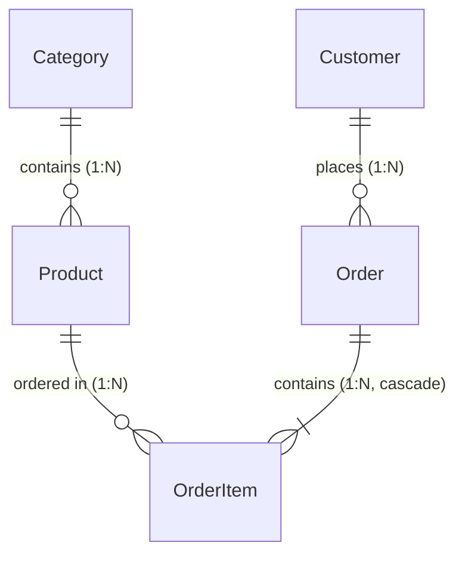

# ecommerce-api

E-commerce REST API built with Node.js, Express 4, TypeScript, PostgreSQL (via Docker), and Prisma 6.

- **Live API URL:** `https://LIVE_URL_PLACEHOLDER`
- **Consumer App:** `/consumer` (React + Vite)
- **Status:** All stages (1 through 8) complete. 119 tests passing. Frozen deterministic seed.

---

## Table of Contents

1. [Quick Start](#quick-start)
2. [Resources & Data Model](#resources--data-model)
3. [Endpoint Reference](#endpoint-reference)
4. [Pagination, Filtering, and Sorting](#pagination-filtering-and-sorting)
5. [Error Handling](#error-handling)
6. [Rate Limiting](#rate-limiting)
7. [Running Locally from a Fresh Clone](#running-locally-from-a-fresh-clone)
8. [Tests](#tests)
9. [Deployment](#deployment)
10. [Design Decisions](#design-decisions)
11. [Evidence](#evidence)
12. [Live URL Placeholder Occurrences](#live-url-placeholder-occurrences)

---

## Quick Start

Prerequisites: Node.js 22+, npm, and Docker.

```bash
# 1. Clone and enter repository
git clone https://github.com/example/ecommerce-api.git
cd ecommerce-api

# 2. Start PostgreSQL in Docker
docker run -d --name ecommerce-postgres \
  -e POSTGRES_USER=user \
  -e POSTGRES_PASSWORD=password \
  -e POSTGRES_DB=ecommerce \
  -p 5432:5432 \
  -v ecommerce-postgres-data:/var/lib/postgresql/data \
  postgres:16-alpine

# 3. Configure environment
cp .env.example .env

# 4. Install dependencies, migrate, and seed
npm install
npx prisma migrate deploy
npx prisma db seed

# 5. Start development server (port 3000)
npm run dev
```

Verify the running server:
```bash
curl -s "http://localhost:3000/api/v1/health"
```
```json
{
  "data": {
    "status": "ok"
  }
}
```

---

## Resources & Data Model

The API manages five core resources: `Category`, `Product`, `Customer`, `Order`, and `OrderItem`.

### Entity Relationship Diagram



### Database Rules & Constraints

- **Primary Keys:** UUID v4 (`@id @default(uuid()) @db.Uuid`) on all tables.
- **Foreign Keys & Deletion Rules:**
  - `Product.categoryId -> Category.id`: `ON DELETE RESTRICT` (cannot delete a category containing products).
  - `Order.customerId -> Customer.id`: `ON DELETE RESTRICT` (cannot delete a customer with order history).
  - `OrderItem.orderId -> Order.id`: `ON DELETE CASCADE` (deleting an order cascades and deletes its line items).
  - `OrderItem.productId -> Product.id`: `ON DELETE RESTRICT` (cannot delete a product referenced in orders).
- **Unique Constraints:**
  - `Category`: `name` is unique (`Category_name_key`); `slug` is unique (`Category_slug_key`).
  - `Customer`: `email` is unique (`Customer_email_key`).
- **PostgreSQL CHECK Constraints:**
  - `Order`: `chk_order_status` enforces `status IN ('pending', 'paid', 'shipped', 'cancelled')`.
  - `Product`: `chk_product_price` enforces `priceMinor >= 0`.
  - `Product`: `chk_product_stock` enforces `stock >= 0`.
  - `OrderItem`: `chk_order_item_quantity` enforces `quantity >= 1`.
  - `OrderItem`: `chk_order_item_unit_price` enforces `unitPriceMinor >= 0`.

---

### Resource Schemas

#### Category
| Field | Type | Required | Notes |
| :--- | :--- | :---: | :--- |
| `id` | `UUID` | Yes | Primary key |
| `name` | `String` | Yes | Unique category title |
| `slug` | `String` | Yes | Unique URL-safe slug derived from name |
| `createdAt` | `DateTime` | Yes | Creation timestamp (ISO 8601) |

#### Product
| Field | Type | Required | Notes |
| :--- | :--- | :---: | :--- |
| `id` | `UUID` | Yes | Primary key |
| `categoryId` | `UUID` | Yes | Foreign key to `Category.id` (`onDelete: Restrict`) |
| `name` | `String` | Yes | Product name |
| `description` | `String` | No | Optional description |
| `priceMinor` | `Integer` | Yes | Price in kobo (NGN minor units); CHECK `priceMinor >= 0` |
| `currency` | `String` | Yes | Defaults to `"NGN"` |
| `stock` | `Integer` | Yes | Inventory stock count; CHECK `stock >= 0` |
| `createdAt` | `DateTime` | Yes | Creation timestamp (ISO 8601) |

#### Customer
| Field | Type | Required | Notes |
| :--- | :--- | :---: | :--- |
| `id` | `UUID` | Yes | Primary key |
| `name` | `String` | Yes | Full name |
| `email` | `String` | Yes | Unique email address |
| `createdAt` | `DateTime` | Yes | Creation timestamp (ISO 8601) |

#### Order
| Field | Type | Required | Notes |
| :--- | :--- | :---: | :--- |
| `id` | `UUID` | Yes | Primary key |
| `customerId` | `UUID` | Yes | Foreign key to `Customer.id` (`onDelete: Restrict`) |
| `status` | `String` | Yes | Order status; CHECK `status IN ('pending', 'paid', 'shipped', 'cancelled')` |
| `currency` | `String` | Yes | Defaults to `"NGN"` |
| `createdAt` | `DateTime` | Yes | Creation timestamp (ISO 8601) |
| `updatedAt` | `DateTime` | Yes | Update timestamp (ISO 8601) |

#### OrderItem
| Field | Type | Required | Notes |
| :--- | :--- | :---: | :--- |
| `id` | `UUID` | Yes | Primary key |
| `orderId` | `UUID` | Yes | Foreign key to `Order.id` (`onDelete: Cascade`) |
| `productId` | `UUID` | Yes | Foreign key to `Product.id` (`onDelete: Restrict`) |
| `quantity` | `Integer` | Yes | Count ordered; CHECK `quantity >= 1`, max 1000 |
| `unitPriceMinor` | `Integer` | Yes | Unit price in kobo copied from product at order time; CHECK `unitPriceMinor >= 0` |

---

## Endpoint Reference

All endpoints are mounted under `/api/v1`. 

> [!NOTE]
> **PowerShell Users:** Use `curl.exe` instead of `curl` (which is aliased to `Invoke-WebRequest`). For JSON request bodies, write the payload to a `.json` file and pass `--data "@body.json"` to prevent PowerShell from stripping quotes.

Every example below targets `https://LIVE_URL_PLACEHOLDER`. Collection outputs use `limit=2` and are shortened for brevity.

---

### 1. Health Check

#### `GET /api/v1/health`
Returns server operational status.

- **Query Parameters:** None
- **cURL:**
  ```bash
  curl -s "https://LIVE_URL_PLACEHOLDER/api/v1/health"
  ```
- **Response (`200 OK`):**
  ```json
  {
    "data": {
      "status": "ok"
    }
  }
  ```

---

### 2. Categories

#### `GET /api/v1/categories`
List categories with pagination, sorting, and search filters.

- **Query Parameters:**
  - `limit` (`integer`, optional, default: `20`, max: `100`): Page size.
  - `offset` (`integer`, optional, default: `0`, min: `0`): Number of records to skip.
  - `sort` (`string`, optional, default: `name`): Whitelist: `name`, `createdAt`.
  - `order` (`string`, optional, default: `asc`): `asc` or `desc`.
  - `name` (`string`, optional): Case-insensitive substring match.
  - `slug` (`string`, optional): Exact lowercase slug match.
- **cURL:**
  ```bash
  curl -s "https://LIVE_URL_PLACEHOLDER/api/v1/categories?limit=2"
  ```
- **Response (`200 OK`, shortened):**
  ```json
  {
    "data": [
      {
        "id": "fd46d528-eb91-49f2-a8eb-bb54ccde88ca",
        "name": "Appliances",
        "slug": "appliances",
        "createdAt": "2026-01-01T00:00:00.000Z"
      },
      {
        "id": "91ffb84d-a2ed-4fb9-96ed-006cf296fdd7",
        "name": "Automotive",
        "slug": "automotive",
        "createdAt": "2026-01-01T00:00:00.000Z"
      }
    ],
    "meta": {
      "total": 20,
      "limit": 2,
      "offset": 0,
      "hasMore": true
    }
  }
  ```

#### `GET /api/v1/categories/:id`
Retrieve a single category by UUID.

- **Path Parameters:**
  - `id` (`UUID`, required): Category ID.
- **Query Parameters:** None
- **cURL:**
  ```bash
  curl -s "https://LIVE_URL_PLACEHOLDER/api/v1/categories/fd46d528-eb91-49f2-a8eb-bb54ccde88ca"
  ```
- **Response (`200 OK`):**
  ```json
  {
    "data": {
      "id": "fd46d528-eb91-49f2-a8eb-bb54ccde88ca",
      "name": "Appliances",
      "slug": "appliances",
      "createdAt": "2026-01-01T00:00:00.000Z"
    }
  }
  ```

#### `GET /api/v1/categories/:id/products`
List all products belonging to a specific category.

- **Path Parameters:**
  - `id` (`UUID`, required): Category ID.
- **Query Parameters:**
  - `limit` (`integer`, optional, default: `20`, max: `100`): Page size.
  - `offset` (`integer`, optional, default: `0`, min: `0`): Number of records to skip.
  - `sort` (`string`, optional, default: `createdAt`): Whitelist: `price`, `name`, `createdAt`.
  - `order` (`string`, optional, default: `desc`): `asc` or `desc`.
  - `minPrice` (`integer`, optional, min: `0`): Minimum price in kobo.
  - `maxPrice` (`integer`, optional, min: `0`): Maximum price in kobo (must be `>= minPrice`).
  - `inStock` (`string`, optional): `true`, `false`, `1`, or `0`.
- **cURL:**
  ```bash
  curl -s "https://LIVE_URL_PLACEHOLDER/api/v1/categories/fd46d528-eb91-49f2-a8eb-bb54ccde88ca/products?limit=2"
  ```
- **Response (`200 OK`, shortened):**
  ```json
  {
    "data": [
      {
        "id": "0a9ba142-db35-4f9c-943c-aa89b45d48bf",
        "name": "Premium Microwave",
        "priceMinor": 6449600,
        "currency": "NGN",
        "stock": 254,
        "createdAt": "2026-01-01T00:00:00.000Z"
      },
      {
        "id": "0be2abea-f558-460b-acb5-850811c0f8f0",
        "name": "Original Vacuum Cleaner",
        "priceMinor": 10681500,
        "currency": "NGN",
        "stock": 254,
        "createdAt": "2026-01-01T00:00:00.000Z"
      }
    ],
    "meta": {
      "total": 20,
      "limit": 2,
      "offset": 0,
      "hasMore": true
    }
  }
  ```

---

### 3. Products

#### `GET /api/v1/products`
List products across all categories with dual pagination (offset or forward cursor).

- **Query Parameters:**
  - `limit` (`integer`, optional, default: `20`, max: `100`): Page size.
  - `offset` (`integer`, optional, default: `0`, min: `0`): Offset paging (mutually exclusive with `cursor`).
  - `cursor` (`string`, optional): Base64URL opaque token from previous `meta.nextCursor` (mutually exclusive with `offset`).
  - `sort` (`string`, optional, default: `price`): Whitelist: `price`, `name`, `createdAt`.
  - `order` (`string`, optional, default: `asc`): `asc` or `desc`.
  - `category` (`string`, optional): Category slug (e.g. `groceries`).
  - `minPrice` (`integer`, optional, min: `0`): Minimum price in kobo.
  - `maxPrice` (`integer`, optional, min: `0`): Maximum price in kobo.
  - `inStock` (`string`, optional): `true`, `false`, `1`, or `0`.
- **cURL:**
  ```bash
  curl -s "https://LIVE_URL_PLACEHOLDER/api/v1/products?limit=2"
  ```
- **Response (`200 OK`, shortened):**
  ```json
  {
    "data": [
      {
        "id": "6dc892dc-a7fe-4a59-8964-6964c815ec5f",
        "name": "Everyday Granulated Sugar - 500g",
        "description": "Durable granulated sugar for daily needs.",
        "priceMinor": 145400,
        "currency": "NGN",
        "stock": 77,
        "createdAt": "2026-01-01T00:00:00.000Z",
        "category": {
          "id": "72669a05-a8da-421a-809f-96a78f6fe311",
          "name": "Groceries",
          "slug": "groceries"
        }
      },
      {
        "id": "6a4609c6-6132-478f-9198-8d30a5044926",
        "name": "Everyday Conditioner - 250ml",
        "description": "Everyday conditioner that does the job.",
        "priceMinor": 165600,
        "currency": "NGN",
        "stock": 293,
        "createdAt": "2026-01-01T00:00:00.000Z",
        "category": {
          "id": "ce561907-8490-40d5-928c-391088abf85c",
          "name": "Beauty & Personal Care",
          "slug": "beauty-personal-care"
        }
      }
    ],
    "meta": {
      "total": 400,
      "limit": 2,
      "offset": 0,
      "hasMore": true,
      "nextCursor": "NmE0NjA5YzYtNjEzMi00NzhmLTkxOTgtOGQzMGE1MDQ0OTI2"
    }
  }
  ```

#### `GET /api/v1/products/:id`
Retrieve a single product by UUID.

- **Path Parameters:**
  - `id` (`UUID`, required): Product ID.
- **Query Parameters:** None
- **cURL:**
  ```bash
  curl -s "https://LIVE_URL_PLACEHOLDER/api/v1/products/6dc892dc-a7fe-4a59-8964-6964c815ec5f"
  ```
- **Response (`200 OK`):**
  ```json
  {
    "data": {
      "id": "6dc892dc-a7fe-4a59-8964-6964c815ec5f",
      "name": "Everyday Granulated Sugar - 500g",
      "description": "Durable granulated sugar for daily needs.",
      "priceMinor": 145400,
      "currency": "NGN",
      "stock": 77,
      "createdAt": "2026-01-01T00:00:00.000Z",
      "category": {
        "id": "72669a05-a8da-421a-809f-96a78f6fe311",
        "name": "Groceries",
        "slug": "groceries"
      }
    }
  }
  ```

---

### 4. Customers

#### `GET /api/v1/customers`
List customers with pagination, sorting, and name/email search filters.

- **Query Parameters:**
  - `limit` (`integer`, optional, default: `20`, max: `100`): Page size.
  - `offset` (`integer`, optional, default: `0`, min: `0`): Offset.
  - `sort` (`string`, optional, default: `name`): Whitelist: `name`, `createdAt`.
  - `order` (`string`, optional, default: `asc`): `asc` or `desc`.
  - `name` (`string`, optional): Case-insensitive substring match.
  - `email` (`string`, optional): Case-insensitive substring match.
- **cURL:**
  ```bash
  curl -s "https://LIVE_URL_PLACEHOLDER/api/v1/customers?limit=2"
  ```
- **Response (`200 OK`, shortened):**
  ```json
  {
    "data": [
      {
        "id": "ae3a192b-4792-4b4a-a2b2-63b4ee3916ba",
        "name": "Abagail Bogisich",
        "email": "abagail.bogisich.210@example.com",
        "createdAt": "2026-01-01T00:00:00.000Z"
      },
      {
        "id": "7b3d933a-d64d-4a77-83a5-f779ec7b9737",
        "name": "Adam Raynor",
        "email": "adam.raynor.155@example.com",
        "createdAt": "2026-01-01T00:00:00.000Z"
      }
    ],
    "meta": {
      "total": 300,
      "limit": 2,
      "offset": 0,
      "hasMore": true
    }
  }
  ```

#### `GET /api/v1/customers/:id`
Retrieve a single customer by UUID.

- **Path Parameters:**
  - `id` (`UUID`, required): Customer ID.
- **Query Parameters:** None
- **cURL:**
  ```bash
  curl -s "https://LIVE_URL_PLACEHOLDER/api/v1/customers/ae3a192b-4792-4b4a-a2b2-63b4ee3916ba"
  ```
- **Response (`200 OK`):**
  ```json
  {
    "data": {
      "id": "ae3a192b-4792-4b4a-a2b2-63b4ee3916ba",
      "name": "Abagail Bogisich",
      "email": "abagail.bogisich.210@example.com",
      "createdAt": "2026-01-01T00:00:00.000Z"
    }
  }
  ```

---

### 5. Orders

#### `GET /api/v1/orders`
List orders with status and customer filters. Totals are computed across the page in one grouped query (`totalMinor`).

- **Query Parameters:**
  - `limit` (`integer`, optional, default: `20`, max: `100`): Page size.
  - `offset` (`integer`, optional, default: `0`, min: `0`): Offset.
  - `sort` (`string`, optional, default: `createdAt`): Whitelist: `createdAt`.
  - `order` (`string`, optional, default: `desc`): `asc` or `desc`.
  - `status` (`string`, optional): Whitelist: `pending`, `paid`, `shipped`, `cancelled`.
  - `customerId` (`UUID`, optional): Valid customer UUID.
- **cURL:**
  ```bash
  curl -s "https://LIVE_URL_PLACEHOLDER/api/v1/orders?limit=2"
  ```
- **Response (`200 OK`, shortened):**
  ```json
  {
    "data": [
      {
        "id": "ef6ac626-cc32-4e0b-b0de-41746a35ca5a",
        "customerId": "d0e7aaea-9182-4b8a-801b-110fb545ca22",
        "status": "paid",
        "currency": "NGN",
        "createdAt": "2026-08-30T13:36:16.257Z",
        "updatedAt": "2026-08-31T02:36:16.257Z",
        "totalMinor": 7481800
      },
      {
        "id": "29687052-7eff-4f0b-a4dd-6744fe341fe8",
        "customerId": "743a0c13-6755-4fa0-b6e4-1c990293884f",
        "status": "paid",
        "currency": "NGN",
        "createdAt": "2026-08-30T10:30:46.455Z",
        "updatedAt": "2026-09-02T01:30:46.455Z",
        "totalMinor": 13654800
      }
    ],
    "meta": {
      "total": 500,
      "limit": 2,
      "offset": 0,
      "hasMore": true
    }
  }
  ```

#### `GET /api/v1/orders/:id`
Retrieve full order details including line items and dynamically computed `totalMinor`.

- **Path Parameters:**
  - `id` (`UUID`, required): Order ID.
- **Query Parameters:** None
- **cURL:**
  ```bash
  curl -s "https://LIVE_URL_PLACEHOLDER/api/v1/orders/ef6ac626-cc32-4e0b-b0de-41746a35ca5a"
  ```
- **Response (`200 OK`):**
  ```json
  {
    "data": {
      "id": "ef6ac626-cc32-4e0b-b0de-41746a35ca5a",
      "customerId": "d0e7aaea-9182-4b8a-801b-110fb545ca22",
      "status": "paid",
      "currency": "NGN",
      "createdAt": "2026-08-30T13:36:16.257Z",
      "updatedAt": "2026-08-31T02:36:16.257Z",
      "items": [
        {
          "id": "5d5a2842-9afa-48ed-988f-9b1b41db6630",
          "productId": "a3620387-83ab-45ea-bb40-dd15aad26160",
          "quantity": 1,
          "unitPriceMinor": 7481800
        }
      ],
      "totalMinor": 7481800
    }
  }
  ```

#### `POST /api/v1/orders`
Create an order and its items in a single atomic `$transaction`. Copies `unitPriceMinor` from product catalog at order time.

- **Headers:** `Content-Type: application/json`
- **Request Body Rules:**
  - `customerId`: Valid UUID of an existing customer (missing -> `422`).
  - `items`: 1 to 50 items (`config.orders.maxItemsPerOrder`).
  - `items[].productId`: Valid UUID of an existing product (missing -> `422`, duplicate -> `422`).
  - `items[].quantity`: Integer between 1 and 1000 (`config.orders.maxQuantityPerItem`).
  - Schema is `.strict()`: extra fields trigger `422`.
- **cURL:**
  ```bash
  curl -i -X POST "https://LIVE_URL_PLACEHOLDER/api/v1/orders" \
    -H "Content-Type: application/json" \
    -d '{
      "customerId": "ae3a192b-4792-4b4a-a2b2-63b4ee3916ba",
      "items": [
        {
          "productId": "6dc892dc-a7fe-4a59-8964-6964c815ec5f",
          "quantity": 2
        }
      ]
    }'
  ```
- **Response (`201 Created`):**
  - **Location Header:** `/api/v1/orders/d1006e2d-edd3-48cd-869f-7959092079b9`
  ```json
  {
    "data": {
      "id": "d1006e2d-edd3-48cd-869f-7959092079b9",
      "customerId": "ae3a192b-4792-4b4a-a2b2-63b4ee3916ba",
      "status": "pending",
      "currency": "NGN",
      "createdAt": "2026-10-20T11:12:31.309Z",
      "updatedAt": "2026-10-20T11:12:31.309Z",
      "items": [
        {
          "id": "45a765c7-cddc-4153-93a5-f4fee7cb5e5b",
          "productId": "6dc892dc-a7fe-4a59-8964-6964c815ec5f",
          "quantity": 2,
          "unitPriceMinor": 145400
        }
      ],
      "totalMinor": 290800
    }
  }
  ```

#### `PATCH /api/v1/orders/:id`
Update an order's status. Returns the complete order detail matching `GET /orders/:id`.

- **Path Parameters:**
  - `id` (`UUID`, required): Order ID.
- **Headers:** `Content-Type: application/json`
- **Request Body:**
  - `status` (`string`, required): One of `pending`, `paid`, `shipped`, `cancelled`.
- **cURL:**
  ```bash
  curl -i -X PATCH "https://LIVE_URL_PLACEHOLDER/api/v1/orders/d1006e2d-edd3-48cd-869f-7959092079b9" \
    -H "Content-Type: application/json" \
    -d '{"status":"paid"}'
  ```
- **Response (`200 OK`):**
  ```json
  {
    "data": {
      "id": "d1006e2d-edd3-48cd-869f-7959092079b9",
      "customerId": "ae3a192b-4792-4b4a-a2b2-63b4ee3916ba",
      "status": "paid",
      "currency": "NGN",
      "createdAt": "2026-10-20T11:12:31.309Z",
      "updatedAt": "2026-10-20T11:12:31.327Z",
      "items": [
        {
          "id": "45a765c7-cddc-4153-93a5-f4fee7cb5e5b",
          "productId": "6dc892dc-a7fe-4a59-8964-6964c815ec5f",
          "quantity": 2,
          "unitPriceMinor": 145400
        }
      ],
      "totalMinor": 290800
    }
  }
  ```

#### `DELETE /api/v1/orders/:id`
Permanently delete an order and cascade-delete its order items.

- **Path Parameters:**
  - `id` (`UUID`, required): Order ID.
- **cURL:**
  ```bash
  curl -i -X DELETE "https://LIVE_URL_PLACEHOLDER/api/v1/orders/d1006e2d-edd3-48cd-869f-7959092079b9"
  ```
- **Response (`204 No Content`):**
  - Empty body. A second `DELETE` to the same ID returns `404 NOT_FOUND`.

---

## Pagination, Filtering, and Sorting

### 1. Pagination Modes: Offset vs. Cursor

All list endpoints (`/categories`, `/categories/:id/products`, `/products`, `/customers`, `/orders`) support offset pagination. In addition, `/products` supports forward-only cursor pagination.

#### Offset Pagination
- `limit`: Number of rows to return (default: `20`, max: `100`).
- `offset`: Number of rows to skip (default: `0`).
- **Response Metadata:**
  ```json
  "meta": { "total": 400, "limit": 20, "offset": 0, "hasMore": true }
  ```
- If `offset` exceeds `total` (e.g. `?offset=5000`), the API returns `200 OK` with `data: []`, `hasMore: false`, and the accurate `total`.

#### Cursor Pagination (`GET /api/v1/products`)
Cursor pagination provides stable, drift-free forward scrolling:
- Pass `cursor=<token>` using the opaque string returned in `meta.nextCursor`.
- `meta` switches to cursor format with **no** `offset`:
  ```json
  "meta": { "total": 400, "limit": 2, "hasMore": true, "nextCursor": "YzJkYTMyYWUtYjU5NC00ZmI5LWE2OTUtMDZlYTFlNDM0OTg3" }
  ```
- **Rules & Restrictions:**
  - Combining `cursor` and `offset` on the same request returns `400 BAD_QUERY_PARAMS`.
  - An empty or malformed cursor returns `400 BAD_QUERY_PARAMS`.
  - If the product named by the cursor has been deleted or no longer satisfies the request filters, the API returns `400 BAD_QUERY_PARAMS` rather than mistakenly pretending the client reached the end of the list.
  - Forward-only: clients traverse forward using `nextCursor`; backward navigation is handled client-side.

#### Worked Cursor Example

**Step 1: Request Page 1**
```bash
curl -s "https://LIVE_URL_PLACEHOLDER/api/v1/products?limit=2"
```
```json
{
  "data": [
    {
      "id": "6dc892dc-a7fe-4a59-8964-6964c815ec5f",
      "name": "Everyday Granulated Sugar - 500g",
      "priceMinor": 145400
    },
    {
      "id": "6a4609c6-6132-478f-9198-8d30a5044926",
      "name": "Everyday Conditioner - 250ml",
      "priceMinor": 165600
    }
  ],
  "meta": {
    "total": 400,
    "limit": 2,
    "offset": 0,
    "hasMore": true,
    "nextCursor": "NmE0NjA5YzYtNjEzMi00NzhmLTkxOTgtOGQzMGE1MDQ0OTI2"
  }
}
```

**Step 2: Request Page 2 with `cursor=NmE0NjA5YzYtNjEzMi00NzhmLTkxOTgtOGQzMGE1MDQ0OTI2`**
```bash
curl -s "https://LIVE_URL_PLACEHOLDER/api/v1/products?limit=2&cursor=NmE0NjA5YzYtNjEzMi00NzhmLTkxOTgtOGQzMGE1MDQ0OTI2"
```
```json
{
  "data": [
    {
      "id": "237bf788-8800-411b-b3ee-ff482ced6c10",
      "name": "Essential Tomato Paste",
      "priceMinor": 206900
    },
    {
      "id": "c2da32ae-b594-4fb9-a695-06ea1e434987",
      "name": "Classic Cat Litter",
      "priceMinor": 246200
    }
  ],
  "meta": {
    "total": 400,
    "limit": 2,
    "hasMore": true,
    "nextCursor": "YzJkYTMyYWUtYjU5NC00ZmI5LWE2OTUtMDZlYTFlNDM0OTg3"
  }
}
```

---

### 2. Clamp-Versus-Reject Rule

The shared pagination validation schema enforces a strict clamp-versus-reject contract across every list endpoint:
- **Clamped:** If `limit` is a positive integer greater than `maxLimit` (`100`), it is clamped to `100`. For example, `?limit=5000` succeeds with `200 OK` and `meta.limit = 100`.
- **Rejected:** If `limit` is `0`, negative (e.g. `?limit=-5`), non-numeric (`?limit=abc`), or empty (`?limit=`), the request is rejected with `400 BAD_QUERY_PARAMS`.

---

### 3. Filtering Rules

- **Empty Filter Values Rejected:** Empty parameters (e.g. `?name=`, `?slug=`, `?minPrice=`, `?status=`) return `400 BAD_QUERY_PARAMS` rather than being silently ignored.
- **Literal LIKE Wildcards:** Special SQL wildcard characters (`%` and `_`) passed in text search filters (`name`, `email`) are escaped and matched literally. A search for `?name=%25` searches for a literal `%` character and returns 0 rows.
- **Multiple Filters Combine with AND:** Supplying multiple filters (e.g. `/customers?name=ann&email=gmail.com`) returns only entities matching both constraints.
- **Price Bounds in Minor Units:** `minPrice` and `maxPrice` are integers representing kobo (`150000` = NGN 1,500.00). Setting `minPrice > maxPrice` returns `400 BAD_QUERY_PARAMS`.

---

### 4. Sorting Whitelists

Every endpoint orders by a strict whitelist, with `id` appended as a deterministic tie-breaker:
- `GET /categories`: `name`, `createdAt` (default: `name asc`).
- `GET /categories/:id/products`: `price`, `name`, `createdAt` (default: `createdAt desc`).
- `GET /products`: `price`, `name`, `createdAt` (default: `price asc`).
- `GET /customers`: `name`, `createdAt` (default: `name asc`).
- `GET /orders`: `createdAt` (default: `createdAt desc`).

Supplying an unknown sort column returns `400 BAD_QUERY_PARAMS`.

---

## Error Handling

All error responses use a predictable, standard error envelope:

```json
{
  "error": {
    "code": "NOT_FOUND",
    "message": "Product not found"
  }
}
```

### Complete Error Code Reference

| HTTP | Error `code` | Scenario |
| :--- | :--- | :--- |
| `400` | `BAD_QUERY_PARAMS` | Invalid query parameters (`limit=0`, negative offset, invalid sort column, empty filter string, malformed UUID in query, `minPrice > maxPrice`, bad cursor token, or cursor combined with offset). |
| `400` | `INVALID_JSON` | Request payload body is not valid JSON. |
| `404` | `NOT_FOUND` | Unknown route, non-existent entity `:id`, malformed `:id` (non-UUID path parameter), or second `DELETE` of an already-deleted order. |
| `413` | `PAYLOAD_TOO_LARGE` | Request payload body exceeds `config.jsonBodyLimit` (`100kb`). |
| `422` | `UNPROCESSABLE_ENTITY` | Request body fails schema validation (extra keys, quantity outside 1–1000, >50 items, duplicate products), or references a customer/product UUID that does not exist in the database. |
| `429` | `TOO_MANY_REQUESTS` | IP exceeds rate limit (`100` requests / `60s`). Includes `Retry-After` header. |
| `500` | `INTERNAL_ERROR` | Unhandled server error. Body always returns generic message `"Internal server error"`; underlying errors are logged server-side only. |

---

## Rate Limiting

Rate limiting is enforced by `express-rate-limit` in `src/app.ts`:
- **Limit:** `100` requests per `60` seconds (`windowMs: 60000`) per IP address.
- **Headers Sent:**
  - `RateLimit-Limit`: `100`
  - `RateLimit-Remaining`: Count of remaining requests in the active window.
  - `RateLimit-Reset`: Seconds remaining until quota reset.
- **Rate Limit Exceeded:**
  - Status: `429 Too Many Requests`
  - Header: `Retry-After: 60`
  - Body:
    ```json
    {
      "error": {
        "code": "TOO_MANY_REQUESTS",
        "message": "Too many requests, please try again later"
      }
    }
    ```
- **Architectural Placement:** The limiter is mounted **above** `express.json()`. Oversized payloads (`413`) and malformed JSON floods (`400`) are counted against the caller's budget before payload parsing occurs.

---

## Running Locally from a Fresh Clone

Follow these exact steps to clone, configure, migrate, seed, and run the service locally:

```bash
# 1. Clone repository
git clone https://github.com/example/ecommerce-api.git
cd ecommerce-api

# 2. Run local PostgreSQL 16 container
docker run -d --name ecommerce-postgres \
  -e POSTGRES_USER=user \
  -e POSTGRES_PASSWORD=password \
  -e POSTGRES_DB=ecommerce \
  -p 5432:5432 \
  -v ecommerce-postgres-data:/var/lib/postgresql/data \
  postgres:16-alpine

# 3. Create .env from template
cp .env.example .env

# 4. Install dependencies (triggers prisma generate in postinstall)
npm install

# 5. Apply migrations
npx prisma migrate deploy

# 6. Seed deterministic database
npx prisma db seed

# 7. Start server in watch mode
npm run dev
```

### Verification
In a second terminal, verify the service is running:
```bash
curl -s "http://localhost:3000/api/v1/health"
```

---

## Tests

Run the Vitest test suite:
```bash
npm test
```

### Test Isolation Architecture
- The test harness uses a `globalSetup` hook in `src/test/global-setup.ts`.
- Tests run against an isolated throwaway database named `ecommerce_test`.
- Setup creates `ecommerce_test`, deploys all migrations, and runs the frozen seed against it.
- Teardown asserts the database name is strictly `ecommerce_test` before executing `DROP DATABASE ... WITH (FORCE)`.
- **Zero Test Contamination:** Your local `ecommerce` development database is never touched or mutated by test runs.
- **Suite Results:** 119 tests passing across 9 test files (`orders.write`, `products`, `categories`, `query-validation`, `orders`, `customers`, `rate-limit-body`, `app`, `rate-limit`).

---

## Deployment

The application is deployed across two platforms: the backend API and PostgreSQL database are hosted on **Railway**, while the React + Vite consumer application is hosted on **Vercel**. For detailed step-by-step setup, smoke testing, and verification procedures, refer to the [Production Deployment Runbook](file:///c:/Users/USER/Desktop/ShopSphere%20API/ecommerce-api/DEPLOY.md).

### Environment Variables Matrix

| Platform | Variable | Type | Description |
| :--- | :--- | :--- | :--- |
| **Railway (API)** | `DATABASE_URL` | Private Reference | `${{Postgres.DATABASE_URL}}` (connects over internal private mesh) |
| **Railway (API)** | `NODE_ENV` | Configuration | `production` |
| **Railway (API)** | `PORT` | Dynamic | Injected automatically by Railway runtime |
| **Railway (API)** | `CORS_ORIGIN` | Configuration | Optional allowed origin; `*.vercel.app` domains are permitted automatically |
| **Vercel (Consumer)** | `VITE_API_URL` | Build-time | `https://LIVE_URL_PLACEHOLDER/api/v1` (baked in at consumer build time) |

### Deployment Overview
1. **Database:** PostgreSQL 16 provisioned on Railway. Production migrations run forward-only via `npx prisma migrate deploy` in the pre-deploy phase.
2. **API Service:** Express application built and started via Nixpacks (`npm run build` -> `npm start`). Verified by automated healthchecks on `/api/v1/health`.
3. **Consumer App:** Built and deployed on Vercel from `/consumer`, pointing `VITE_API_URL` to `https://LIVE_URL_PLACEHOLDER/api/v1`.

---

## Design Decisions

Each decision below lists the rationale alongside the alternative considered.

1. **Normalized Five-Resource Schema:** `Category`, `Product`, `Customer`, `Order`, `OrderItem`. Normalized tables model distinct domain lifecycles, enforce referential integrity (`RESTRICT` on products/customers; `CASCADE` on order items), and allow database indexing on query filters (`categoryId`, `priceMinor`, `status`). *Alternative considered:* A denormalized document structure storing order items in a JSON column on `Order`. Rejected because relational tables guarantee referential integrity and enable performant SQL aggregations.
2. **UUID Primary Keys:** Uses UUID v4 (`@id @default(uuid()) @db.Uuid`) across all entities. UUIDs prevent resource enumeration attacks and leak no volume or creation order. *Alternative considered:* Sequential autoincrement integers (`Int @id @default(autoincrement())`). Rejected because sequential integers expose business transaction volumes and facilitate ID-scraping attacks.
3. **Money Stored as Integer Kobo:** Prices and unit prices are stored in minor units (`priceMinor`, `unitPriceMinor` in kobo) with a `currency` column (`"NGN"`). Whole integer arithmetic eliminates IEEE-754 floating-point rounding errors. *Alternative considered:* Decimal columns or floating-point numbers. Floats introduce precision loss; Decimal types introduce conversion overhead across runtime layers.
4. **Computed Order Totals:** Order totals are evaluated on read via `SUM(quantity::bigint * unitPriceMinor)` and never stored on `Order`. Casting `quantity` to `bigint` prevents integer overflow on 32-bit integers before summation. *Alternative considered:* Storing a cached `totalMinor` column on `Order`. Rejected because cached totals risk data drift when items are written or modified.
5. **Database-Level CHECK Constraints:** Constraints (`chk_order_status`, `chk_product_price`, `chk_product_stock`, `chk_order_item_quantity`, `chk_order_item_unit_price`) are enforced by PostgreSQL. Guarantees data integrity at the database boundary regardless of client or script access. *Alternative considered:* Application-only Zod validation or Prisma enums. Application checks fail if data is written through external scripts; Prisma enums require migrations to add values and lack text portability.
6. **Dual Pagination on `/products`:** `/products` supports both offset and cursor pagination; smaller resources use offset only. Cursor pagination provides fast, drift-free forward scrolling under active inventory updates. *Alternative considered:* Cursor-only everywhere or offset-only everywhere. Offset-only degrades at depth on large collections; cursor-only eliminates direct page jumps on small collections where offset is lightweight.
7. **Uniform Success and Error Envelopes:** Collections return `{ data, meta }`; single items and `/health` return `{ data }`. All errors return `{ error: { code, message } }`. Guarantees predictable client consumption and strong typing. *Alternative considered:* Bare root arrays (`[...]`) and unstructured errors. Bare arrays prevent returning pagination metadata; unstructured errors complicate frontend error handling.
8. **Semantic 422 for Missing Referenced Entities:** If an order write payload references a nonexistent `customerId` or `productId`, the API responds with `422 UNPROCESSABLE_ENTITY` naming the field, rather than `404 NOT_FOUND`. `404` is reserved strictly for non-existent endpoint URLs and missing `:id` path parameters. *Alternative considered:* Returning `404 NOT_FOUND` for missing foreign references. Rejected because the target collection URL `/api/v1/orders` exists; blaming `404` falsely indicates that the route or endpoint was not found.
9. **Rate Limiting Above Body Parser:** The rate limit of 100 requests per 60 seconds is mounted above `express.json()`. Oversized payloads (`413`) and malformed JSON floods (`400`) are metered against the caller's quota before body parsing occurs. *Alternative considered:* Mounting the limiter below body parsing, or using per-route limits. Mounting below body parser permits DDoS vectors via malformed/oversized payload flooding; complex tiering is unnecessary for an unauthenticated public API.
10. **Unauthenticated Write Endpoints:** `POST`, `PATCH`, and `DELETE` on orders require no authentication tokens by explicit project specification. Abuse is bounded by IP rate limiting, strict payload size limits (100kb), write constraints (max 50 items, max 1000 quantity), and an idempotent seed script. *Alternative considered:* API keys or JWT sessions. Rejected because authentication was excluded from the assessment brief and adds external state without requirement.

---

## Evidence

Post-deployment evidence checklist for graded assessment submission:

- [ ] **Live API URL:** `https://LIVE_URL_PLACEHOLDER`
- [ ] **Paginated cURL Screenshot:** `docs/evidence/curl-pagination.png` (Terminal screenshot showing paginated JSON response)
- [ ] **Rate Limiting 429 Screenshot:** `docs/evidence/rate-limit-429.png` (Terminal screenshot showing 429 response with `Retry-After`)
- [ ] **Consumer Application Screenshot:** `docs/evidence/consumer-app.png` (Web app running in browser displaying data from the live API)
- [ ] **Seed Script Link:** [`prisma/seed.ts`](file:///c:/Users/USER/Desktop/ShopSphere%20API/ecommerce-api/prisma/seed.ts)
- [ ] **Ugly-Inputs / Edge-Case Evidence:** [`docs/evidence/ugly-inputs.md`](file:///c:/Users/USER/Desktop/ShopSphere%20API/ecommerce-api/docs/evidence/ugly-inputs.md)

---

## Live URL Placeholder Occurrences

The placeholder `https://LIVE_URL_PLACEHOLDER` appears in the following locations within this document for easy replacement after deployment:

1. **Header / Overview section** (line 5)
2. **Endpoint Reference intro** (line 164)
3. **Endpoint 1 (`GET /api/v1/health`)** (line 176)
4. **Endpoint 2 (`GET /api/v1/categories`)** (line 203)
5. **Endpoint 3 (`GET /api/v1/categories/:id`)** (line 239)
6. **Endpoint 4 (`GET /api/v1/categories/:id/products`)** (line 268)
7. **Endpoint 5 (`GET /api/v1/products`)** (line 319)
8. **Endpoint 6 (`GET /api/v1/products/:id`)** (line 372)
9. **Endpoint 7 (`GET /api/v1/customers`)** (line 410)
10. **Endpoint 8 (`GET /api/v1/customers/:id`)** (line 446)
11. **Endpoint 9 (`GET /api/v1/orders`)** (line 476)
12. **Endpoint 10 (`GET /api/v1/orders/:id`)** (line 518)
13. **Endpoint 11 (`POST /api/v1/orders`)** (line 555)
14. **Endpoint 12 (`PATCH /api/v1/orders/:id`)** (line 601)
15. **Endpoint 13 (`DELETE /api/v1/orders/:id`)** (line 635)
16. **Pagination worked example - Step 1** (line 674)
17. **Pagination worked example - Step 2** (line 702)
18. **Deployment section** (lines 881 & 886)
19. **Evidence section** (line 911)
